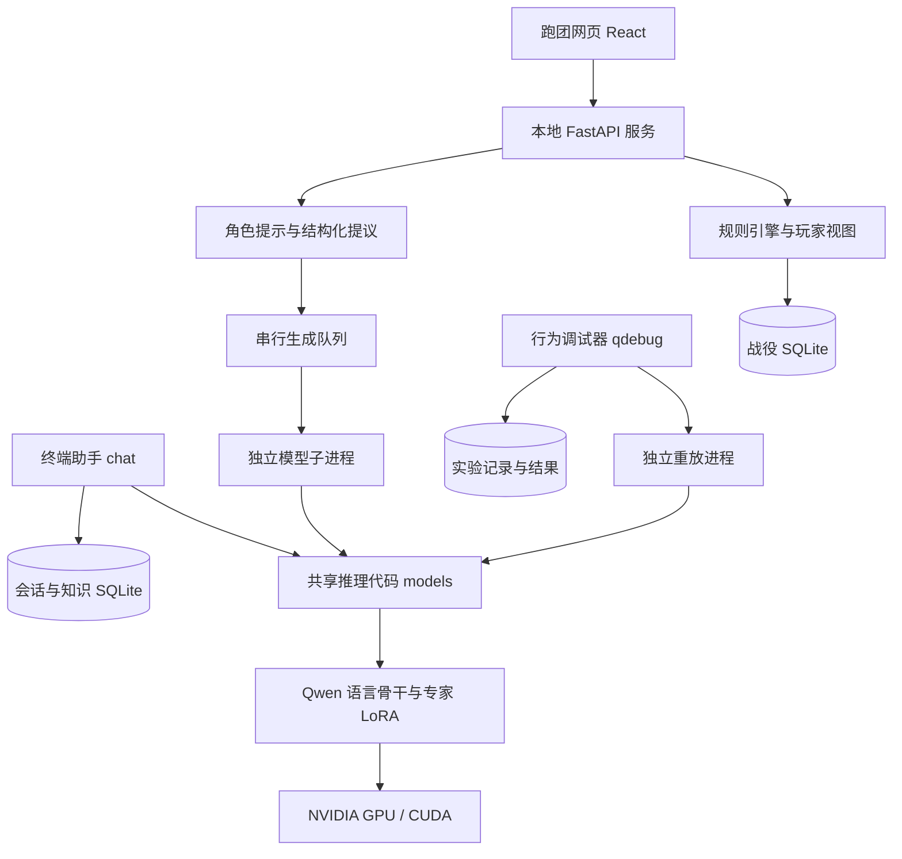
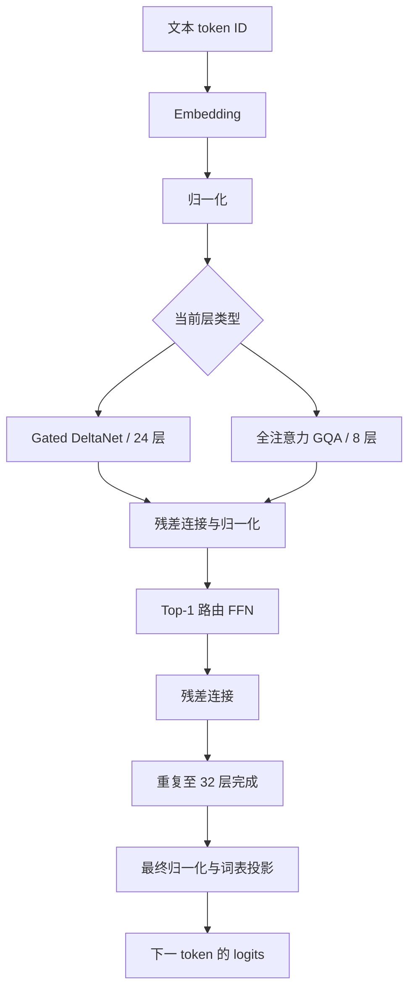
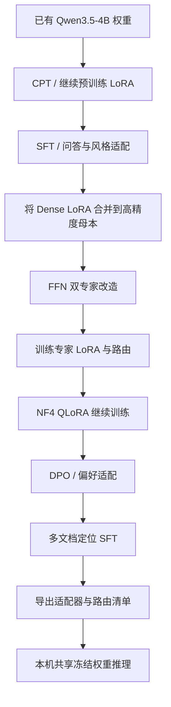
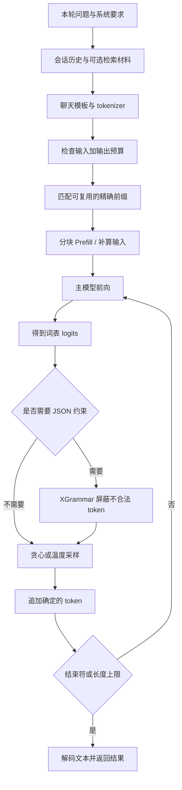
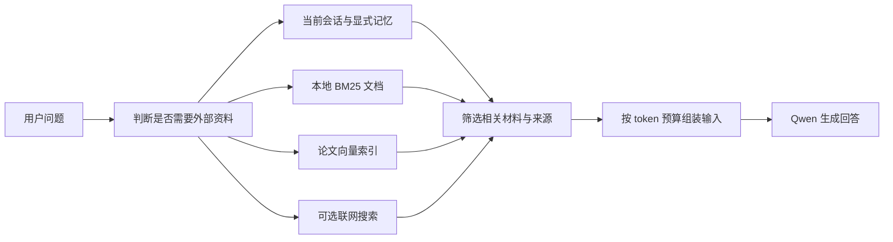
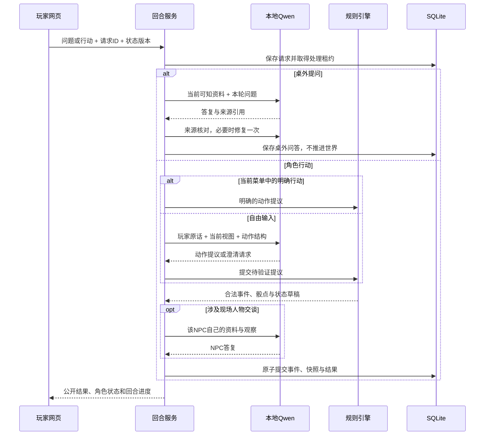

# 本地小型语言模型与多角色文字冒险

## 1. 项目是什么

本项目以 **Qwen3.5-4B 权重**为基础，低成本微调、双专家和本地推理优化，提供终端助手、文字跑团和模型行为调试三种使用方式。


| 组成 | 解决的问题 | 主要代码 |
|---|---|---|
| 定制语言模型与推理运行时 | 加载、生成、复用上下文 | `models/` |
| 终端助手 | 聊天、会话管理、显式记忆、文档检索和联网搜索 | `models/chat_pretrained.py` 等 |
| 多角色文字冒险 | 角色对话、规则裁定、信息隔离、战役与存档 | `local-trpg/` |
| 模型行为调试器 | 留存错误案例，重放、对照和比较不同配置 | `src/qwen_debugger/` |
| 云端训练脚本 | 生成微调适配器、专家路由和导出模型 | `scripts/cloud_qwen35_*.py` |

基础语言知识来自预训练 Qwen。项目自身的工作集中在模型适配、稀疏专家、低显存执行、交互流程与可追溯状态管理，没有从零预训练一个 4B 基础模型。

当前版本只处理文本，不构建视觉编码器，不提供图片、视频或语音理解。

## 2. 总体架构



“共享推理代码”表示复用同一个模型实现。应用默认各自管理模型进程，没有部署一个供所有客户端同时调用的公共模型服务器。

跑团服务和模型使用独立 Python 环境，通过标准输入、标准输出交换 JSON。应用依赖与 PyTorch/CUDA 依赖因此可以分开管理。

## 3. 技术栈


| 层级 | 技术或框架 | 作用 |
|---|---|---|
| 语言 | Python、TypeScript | 模型、后端、训练与前端 |
| 张量计算 | PyTorch、CUDA | GPU 前向、训练、SDPA 注意力与 CUDA Graph |
| 模型与分词 | Transformers 5.17.0、Tokenizers、Safetensors | Qwen 语言骨干、聊天模板、权重读取 |
| 参数高效微调 | PEFT 0.21.0 | 注入、训练和加载 LoRA |
| 量化 | bitsandbytes 0.50.2 | NF4 权重、双重量化、训练阶段的分页 8bit 优化器 |
| GPU 内核 | Triton、flash-linear-attention / fla-core 0.5.2 | 融合投影、量化 KV、卷积与 DeltaNet 快速路径 |
| 结构化生成 | XGrammar 0.2.8、Pydantic | 限制 JSON 结构并验证请求、提议和事件 |
| Web 后端 | FastAPI 0.115.12、Uvicorn 0.34.2 | 本机 HTTP 接口和前端静态资源托管 |
| Web 前端 | React 19、TypeScript 5.9、Vite 7 | 跑团阅读界面、角色卡、输入和存档操作 |
| 状态持久化 | SQLite、SQLite FTS5 | 战役事务、会话、显式记忆和 BM25 检索 |
| 向量检索 | multilingual-e5-small、NumPy | 论文摘要编码与分块余弦相似度检索 |
| 终端交互 | Rich、prompt_toolkit | Markdown 输出、交互输入和命令补全 |
| 公式显示 | KaTeX、UnicodeIt | 终端公式文本转换与独立网页公式查看 |
| 训练辅助 | Transformers Trainer、Accelerate、PyArrow | 训练调度、混合精度、Parquet 数据读取 |

云端训练有单独依赖清单。对应入口为 `requirements-qwen35-local.txt`、`requirements-qwen35.txt` 和 `local-trpg/pyproject.toml`。

## 4. 模型结构与MoE

### 4.1 基础结构

 Qwen 包含 32 个解码层，隐藏维度为 2560：

- 24 层线性注意力，采用 Gated DeltaNet。
- 8 层全注意力，每隔四层出现一次，采用分组查询注意力 GQA。
- 全注意力配置为 16 个查询头、4 个 KV 头，head dimension 为 256。
- 输入 embedding 与输出词表投影共享权重。

项目增加 FFN 专家改造和执行优化，没有重新预训练。



图中省略了部分内部投影和门控细节；它描述的是一层接一层的计算顺序，两类注意力不会在同一层同时执行。

### 4.2 MoE

每层 FFN 包装成两个专家，由一个路由器为每个 token 选择其中一个，称为 **Top-1 路由**。

推理时两个专家共享同一份冻结的基础矩阵，保留各自独立的 LoRA 参数。

对某个线性投影，可以将计算写成：

```text
专家 i 的投影 = 共享基础投影 + 该专家的 LoRA 增量
              = W_base × x + scale_i × B_i × A_i × x

p = softmax(router(x))
选中专家 = argmax(p + 路由偏置项)
FFN 输出 = 2 × p[选中专家] × 被选专家的 FFN(x)
```

FFN 内部仍有 gate、up、down 三类投影与非线性运算。

核心文件：[`models/qwen35_moe.py`](models/qwen35_moe.py)、[`models/text_only_qwen35.py`](models/text_only_qwen35.py)。

## 5. 训练

以下是保留训练代码的阶段关系，正常聊天和跑团不会自动训练。



| 方法 | 输入与目标 | 项目实现 |
|---|---|---|
| CPT | 用新增文本继续学习语言建模目标 | `cloud_qwen35_lora.py` 等 |
| SFT | 用问题与目标回答调整输出方式 | 同一训练入口与后续任务脚本 |
| LoRA | 冻结大矩阵，只更新低秩增量 | PEFT；注意力和 FFN 的指定投影 |
| 专家训练 | 训练不同专家增量与路由分配 | `cloud_qwen35_followup.py`、`qwen35_moe.py` |
| QLoRA | 在冻结的 NF4 基座上继续更新适配参数 | `cloud_qwen35_qlora.py` |
| DPO | 同一问题提供优选、较差回答，优化相对偏好 | `cloud_qwen35_dpo.py` 自定义 Trainer |
| 长输入适配 | 多篇摘要中的文档定位与回答 | `cloud_qwen35_long.py` |

训练阶段还使用混合精度、梯度累积、梯度检查点及回答位置损失。`models/assistant_loss.py` 只对需要监督的位置进行大词表投影；模型仍读取完整输入，梯度仍经过上下文计算。

DPO 代码先记录参考模型对偏好对的分数，再训练当前模型，不需要另外训练奖励模型或建立 PPO 在线采样循环。[LoRA](https://arxiv.org/abs/2106.09685)、[QLoRA](https://arxiv.org/abs/2305.14314)、[DPO](https://arxiv.org/abs/2305.18290)。

当前保留的长输入训练脚本主要使用 4K 样本。

## 6. 一次 LLM 回答的完整流程

### 6.1 输入

1. 读取系统要求、本轮问题和当前会话。
2. 按需要检索记忆、文档或网页，保留材料的来源与状态。
3. 使用 Qwen tokenizer 和聊天模板，将消息转换成 token ID。
4. 按真实 token 数检查预算，为输出预留空间，必要时缩减旧历史或检索材料。

### 6.2 Prefill 与 Decode

**Prefill** 处理本轮输入：生成全注意力层的 KV，并更新线性注意力层的递归状态。长输入分块处理，以控制临时显存。

**Decode** 每次计算下一 token 的分数，再按当前采样规则选出 token。已经计算的缓存会被继续使用，随后 token 加入上下文，直到遇到结束符或达到输出预算。



普通聊天可以流式显示。token 与汉字不是一一对应，文本解码和 Markdown 排版也可能暂存片段，所以显示过程不保证每次恰好增加一个字。

跑团界面主要显示完整、经过验证的角色答复或回合结果，不把模型的原始 JSON token 直接当作故事逐字输出。

入口：[`models/pretrained.py`](models/pretrained.py)、[`models/cached_generation.py`](models/cached_generation.py)、[`models/chat_pretrained.py`](models/chat_pretrained.py)。

## 7. 低显存与提速技术

### 7.1 

| 技术 | 解决的问题与实现方式 | 状态 |
|---|---|---|
| 纯文本加载 | 只构建语言解码器，不先分配视觉参数 | 使用 |
| 共享冻结基础矩阵 | 两个专家复用基础权重，独立保存低秩增量 | 推理使用 |
| NF4 与双重量化 | 压缩主要基础线性权重；计算仍需相应高精度运算 | 使用 |
| 冻结 NF4 启动缓存 | 已有有效缓存时直接读取，避免每次从高精度母本重新量化 | 当前支持，缓存可用时使用 |
| Q8 KV cache | 历史 K/V 低比特保存，近期部分保留高精度 | 当前聊天与跑团默认 |
| Q4 KV cache | 更小的历史缓存，但误差与兼容性需要单独评估 | 可选 |
| 直接压缩 KV 解码 | 单查询时在内核局部解包，不构造整段高精度历史 K/V | 受支持条件下使用 |
| 专家及注意力 LoRA 融合 | 合并多个小投影步骤，减少 GPU 算子启动和中间读写 | 受支持的解码路径使用 |
| FLA 与卷积快速路径 | 加速 DeltaNet、递归更新及因果卷积 | 条件满足时使用，否则回退 |
| 局部 CUDA Graph | 对固定形状专家基础计算捕获与复放 | 默认允许；不是整模型 Graph |
| RMSNorm 与解码缓冲复用 | 融合归一化相关操作，复用 token、位置等小张量 | 受支持条件下使用 |
| 精确前缀缓存 | 相同角色固定提示已经算过时复用部分缓存 | 当前支持，按角色和战役隔离 |
| 原生 MTP 两 token 验证 | 草稿提议后由主模型验证，拒绝时恢复缓存 | 实验可选，默认关闭 |
| 原生 NVFP4 | 独立投影量化和矩阵计算试验 | 未作为整模型默认格式 |


这些优化有形状、精度、缓存、梯度和设备限制。

### 7.2 权重量化与 KV 量化的区别

**NF4 权重量化**压缩模型的主要基础矩阵，主要影响模型常驻空间。它不表示 embedding、归一化、路由器、LoRA 和所有临时张量均为 4bit。

**KV 量化**压缩随上下文增长的注意力历史。本地实现参考 K/V 非对称分组思路：K 按时间块组织，V 按通道组组织，并保留近期高精度残留。[KIVI 论文](https://arxiv.org/abs/2402.02750)。

线性注意力保存卷积与递归状态，全注意力保存历史 K/V，本模型的缓存是混合结构。

### 7.3 上下文窗口的实际含义

| 场景 | 当前配置或记录 | 讲解边界 |
|---|---|---|
| 终端聊天 | 默认总预算 65,536 token，默认最大新输出 8,192 token | 输入与输出共同占窗口，不保证每次输出到上限 |
| 跑团模型 worker | 固定总预算 6,144 token | 使用角色局部资料和记忆选择，未默认输入整部模组 |
| 跑团角色输入 | 常规角色请求进一步检查约 4,096 输入 token 预算 | 还保留输出、来源核对与修复空间 |
| 256K 长窗口 | Q8 模式有一次 262,048-token 输入的真实记录 | 合成长文中的三个档案码找回成功，不等于普遍长文理解可靠 |

256K 样例首次读入约 463 秒，PyTorch 分配峰值约 9.12 GiB，解码约 6.09 token/s。
### 7.4 MTP 为什么未默认打开

MTP 使用额外预测 head 提议未来 token，再由当前定制主模型验证。拒绝时必须同时恢复全注意力缓存、量化块及 DeltaNet 的卷积和递归状态，不能只截短普通 KV。[推测解码论文](https://arxiv.org/abs/2211.17192)。

当前实现仅支持普通文本、单会话、贪心解码；不能同时使用非零温度、跑团 JSON 约束或固定角色提示缓存。短代码任务有收益，解释类任务可能更慢；部分输入还出现了与逐 token 路径不同的措辞。因此保留为实验。

### 7.5 少量实测数据

| 对照 | 实测结果 | 结果适用范围 |
|---|---|---|
| 现场量化与读取冻结 NF4 缓存 | 加载约 153.2 → 48.4 秒 | 一次本机加载对照，不是生成速度提升 |
| 局部专家 CUDA Graph 开关 | 解码约 14.43 → 16.14 token/s | 六组成对短输出，不代表全部任务 |
| MTP 开关，Q8 短代码任务 | 约 17.67 → 22.50 token/s | 贪心短代码，不能用于跑团 JSON 路径 |
| 同一 MTP 对照中的解释任务 | 约 17.24 → 14.46 token/s | 展示低接受率任务可能变慢 |

相关记录说明见 `docs/TEXT_RUNTIME_UPGRADE_2026-10-15.md`、`docs/RUNTIME_PHASE3_2026-10-15.md` 和 `docs/RUNTIME_PHASE6_2026-10-15.md`。

## 8. 记忆、RAG 与联网检索

终端助手可以从不同来源补充上下文：

| 来源 | 做法 | 注意事项 |
|---|---|---|
| 会话历史 | 按会话保存和恢复消息 | 不默认把不同会话混入同一上下文 |
| 显式记忆 | 用户主动保存内容，后续检索 | 聊天不会自动更新模型权重 |
| 本地全文检索 | SQLite FTS5 / BM25；中文按相邻字组合处理 | 关键词命中不等于事实已确认 |
| 论文向量检索 | E5 编码，归一化后做余弦相似度排序 | 依赖另行准备的编码模型与索引文件 |
| 联网搜索 | 按问题和模式获取网页结果，读取正文片段 | 超时、无结果和取得证据是不同状态 |



**跑团不默认使用互联网补写世界设定。**它从当前模组、角色实际观察和已取得线索组装资料，避免把外部常识当成剧情事实。与终端助手的联网流程分开。

主要文件：`models/retrieval.py`、`semantic_retrieval.py`、`web_retrieval.py`、`retrieval_policy.py`。

## 9. 多角色文字跑团的工作流程

### 9.1 模型和程序各自负责什么

| 工作 | 负责方 |
|---|---|
| 理解自由输入并提出动作 | Qwen 行动解释器 |
| 玩家选择了明确的当前行动 | 程序直接形成提议，不再要求模型分类 |
| NPC 台词和桌外答疑 | Qwen，使用各自限定资料 |
| 检定、资源、移动、伤害和任务条件 | 规则引擎 |
| 哪个人听见或看见事件 | 感知与视图投影代码 |
| 哪些结果正式进入战役 | SQLite 事务与事件提交 |

多个 NPC 使用同一个模型，区别来自角色身份、资料、观察、目标与调用上下文。

### 9.2 一个回合如何执行



图中合并了不同模组的共同流程。普通 NPC 问答不会自动执行治疗或交付物品；真正的机械操作由规则引擎产生事件。

默认 `brief` 模式直接呈现规则已产生的现场描述和实际人物台词，普通操作省去一次额外叙述模型调用。可选 `model` 模式才让 Qwen重新组织行动叙述。


### 9.3 当前两个模组

| 模组 | 规则与内容 | 范围 |
|---|---|---|
| 备用冷却 | 原创船舱救援，2d6、时间事件、人员与物资目标 | 独立的船员规则引擎 |
| 松溪镇危机 / Pinebrook | 官方短冒险的中文单人适配，d20、四张卡、三名同伴、两场战斗、护送结局 | 使用独立场景引擎，未实现完整 D&D 5版 |

Pinebrook 基于 Wizards of the Coast 公开的 [Peril in Pinebrook](https://www.dndbeyond.com/posts/1625-peril-in-pinebrook-a-free-introductory-adventure)。

讲解入口：`local-trpg/src/local_trpg/api.py` → `adventure/service.py` → `adventure/engine.py` → `adventure/views.py` → `storage.py`；网页交互看 `local-trpg/web/src/Player.tsx` 与 `client.ts`。

## 10. 模型行为调试器

调试器用于研究模型在什么条件下出错。

工作流程：**登记案例 → 冻结运行配置 → 调用真实模型重放 → 记录结果 → 缩减或改变输入条件 → 独立确认 → 比较版本 → 导出报告**。

它保存输入、输出、token、运行配置、预算和实验关系，避免只凭某次正确回答判断修复成功。人工审核、模拟结果和真实模型结果分开保存。

主要文件：`src/qwen_debugger/domain.py`、`runner.py`、`shrink.py`、`confirmation.py`、`suites.py`、`web.py`。本地工作台入口为 `qdebug serve`，默认端口 8765。

